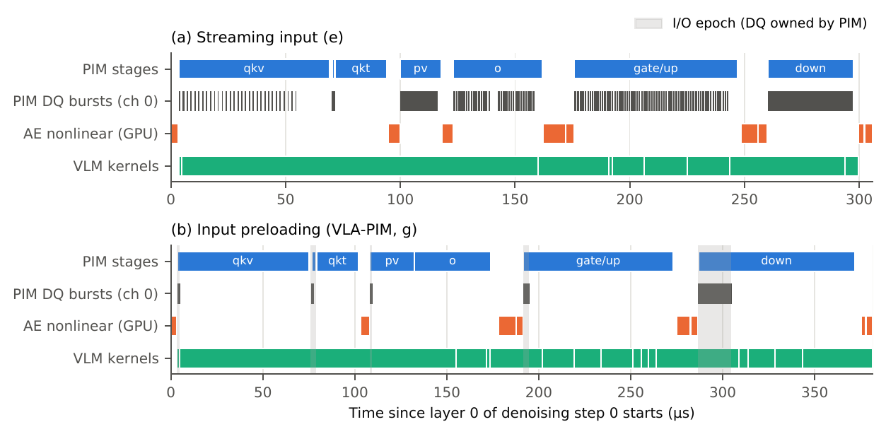
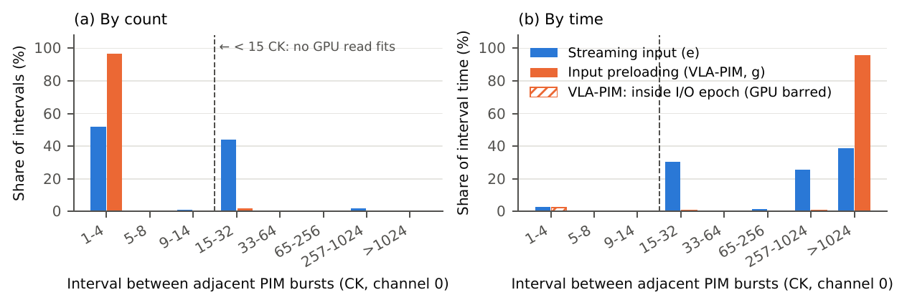
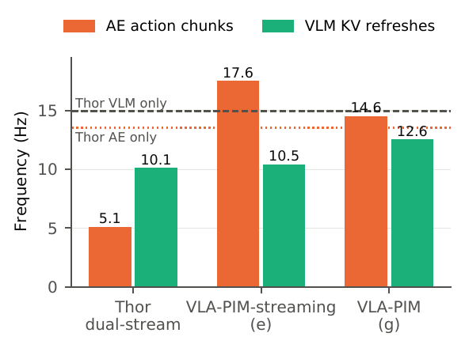

# VLA-PIM 初稿 v2：第 III 节（架构设计）至第 VII 节（结论）

> 写作说明（不进论文）

> - 依据 `ActPIM_初稿_v1.docx`：黄色部分保留原意并润色；橙色部分按【】中的提示重写；其余非高亮的指示性文字（如“这一段要重写”）当作提示处理。  
> - 系统名沿用 v1 第 III 节之后的写法，统一为 **VLA-PIM**。v1 摘要和引言中仍有 ActPIM，投稿前需要全局统一。  
> - 数据全部来自 `experiments/2026-11-16/`（每组两次，raw 逐字节一致；c–g 与 1115 发布结果逐字节一致）和 1115 的 Thor 实测。  
> - 数据图由 `essay/figures/plot_paper_figures.py` 生成，PDF/PNG 在同一目录。  
> - 【待核】【待补】为本稿无法从现有数据得出、需要你补充的内容。

---

## III 架构设计

### A. 系统概览

VLA-PIM 是面向并行 VLA 推理的 GPU–LPDDR5X-PIM 异构系统，整体架构如图 4 所示。GPU 执行 VLM，以及 AE 中的归一化、softmax 等非线性算子；PIM 承担 AE 的线性算子，并在本地执行 RoPE。

为使 VLM 与 AE 并行执行，VLA-PIM 以 rank 为粒度划分存储资源：每个 LPDDR5X 通道中的一个 DRAM rank 服务 GPU 上 VLM 的访存，另一个 PIM rank 执行 AE。选择 rank 粒度的原因在于 LPDDR 的存储层次。Channel 是 LPDDR 的最高层级，一个封装内的两个 channel 各有独立的 C/A 与 DQ 接口；若按 channel 划分，交给 PIM 的通道不再为 GPU 供数，GPU 可用带宽随之减半。Rank 则是存储与计算能够时分复用的最高层级：同一 channel 的两个 rank 拥有独立的存储阵列，由各自的 CS 选通，但共享该 channel 的 DQ 与 C/A 总线。因此，PIM rank 利用 bank 内部带宽计算时，全部通道仍可通过 DRAM rank 向 GPU 供数，外部传输带宽与内部计算带宽可以同时得到利用。若继续下探到 bank group 或 bank 粒度，同一 rank 内的 bank 需要分别维持常规访存与 PIM 执行两种状态，并同时处理两类命令，控制逻辑明显更复杂。综上，rank 划分是额外开销最小的方案；它的代价是两个 rank 争用共享的 DQ 总线，这正是后文要解决的问题。

具体配置上，VLA-PIM 采用 8 个 LPDDR5X-8533 封装（参考美光【待核：型号】），每个封装为四裸片、双通道、双 rank，共提供 16 个独立的 x16 通道，峰值带宽 273 GB/s。

每个 PIM rank 包含 4 个 bank group，每组 4 个 bank。其计算组织参考 Samsung 公布的 LPDDR5X-PIM\[4\]：每个 bank 配一个 16 × BF16 MAC 单元（FP32 累加）和一个 RoPE 单元，并配备 1 KiB 输入缓冲（Input Buffer）和 2 KiB 输出缓冲（Output Buffer）；BG 级与 rank 级累加器逐级汇聚各层级的求和结果。与 Samsung 器件的关键规格比较见表 IV。

**表 IV：PIM rank 关键规格**

| 项目 | VLA-PIM | Samsung LPDDR5X-PIM\[4\] |
| :---- | :---- | :---- |
| 接口 | LPDDR5X-8533，x16，BG 模式 | 【待核】 |
| 每 rank bank 数 | 16（4 BG × 4） | 【待核】 |
| 每 bank 计算单元 | 16 × BF16 MAC（FP32 累加），256-bit | 【待核】 |
| 每 bank 输入缓冲 | 1 KiB | 【待核】 |
| 每 bank 输出缓冲 | 2 KiB（FP32） | 【待核】 |
| 本地 RoPE | 每 bank 1 个 | 无 |
| 新增数据通路 | Row Buffer → Input Buffer 广播（输入预装载） | 无 |

在这一结构上，VLA-PIM 从“组织传输时序”和“减少传输量”两个方面缓解共享总线争用。在微架构层面，VLA-PIM 增加一条从 Row Buffer 到 Input Buffer 的通路：输入先集中写入 PIM rank 的 DRAM，再在 rank 内广播给各 bank，从而把计算阶段的逐片供数留在 rank 内，为 GPU 形成连续的访存窗口（第 III-B 节）；相应的命令以 JEDEC 兼容的方式编码（第 III-C 节）。在数据流层面，VLA-PIM 采用面向共享总线的 token-wise 布局，并在 bank 内完成 RoPE，以减少必须经过 DQ 的数据（第 IV-A 节）。最后，GPU–PIM 协同调度在 kernel 粒度上划分两者对 DQ 的所有权，把上述机制组合成并行执行（第 IV-B 节）。

### B. 输入预装载微架构

已有 LPDDR5X-PIM 等设计把输入从主机流式送入，使 DQ 总线在整个算子执行期间被间歇占用。这对 VLA-PIM 中频繁的 rank 切换并不友好：要么以高频数据时钟空转的功耗为代价，让两个 rank 的 WCK 保持同步；要么为每次切换付出 WCK 同步与总线读写转向（R/W turnaround）的时间。按 JEDEC LPDDR5X-8533 时序，PIM 写之后接 GPU 读、再回到 PIM 写，DQ 边界开销合计 13 CK；再加上一次 2 CK 的读突发，至少需要 15 CK 的间隔，才能插入一次 GPU 读。Ramulator 仿真显示，在流式供数下，PIM 相邻数据突发之间的间隔有 52.9% 短于 15 CK（图 8(a)），无法用于发射任何 GPU 访存请求。若要利用剩余较长的间隔，MC 还需要 DQ lookahead，预判每个间隔能否容纳一次 GPU 访存的 DQ 突发，仲裁逻辑因此变得复杂。

因此，VLA-PIM 提出一种对 rank 划分更友好的微架构：在每个 bank 内增加一条从 Row Buffer 到 Input Buffer 的通路，支持输入预装载（input-preloaded）数据流（图 5）：

1. **集中装载。** PIM rank 处于 DRAM 模式时，主机用普通 WR 以满带宽把一个算子的全部输入一次性写入 PIM rank 的输入区（Row I）。  
2. **本地广播。** PIM rank 切换到 PIM 模式后，MC 对 Row I 发出 ACT，随后 RD 读出的列数据被广播到全部 16 个 bank 的 Input Buffer。  
3. **本地计算与写回。** MAC 结果写回 DRAM 的结果区；计算结束后，主机在 DRAM 模式下一次性读出结果。

这样做有两点好处。（a）**DQ 空隙融合。** 原本分散在整个算子中的输入传输被集中到算子开头，PIM 计算期间 DQ 完全交还 GPU，GPU 获得长而连续的访存窗口。（b）**免去细粒度仲裁。** 输入提前就绪后，MC 不再需要用 DQ lookahead 判断空隙能否插入 GPU 指令。

**C/A 占用。** AE 的线性算子为 skinny GEMM ，一条列命令RD 使 M 行输入完成 MAC，命令密度不高。仿真中，PIM 阶段内 PIM rank 只占外部 C/A 周期的 14.4%，与 GPU 的 C/A 合计 54.4%，C/A 总线并未饱和。预装载也没有增加 C/A 负担：流式供数下 PIM rank 的 C/A 占用为 16.2%（第 V-B 节）。

### C. PIM 命令接口与 ISA 扩展

VLA-PIM 在 JEDEC LPDDR5X 命令集上扩展出 PIM 模式，并设计了存储侧的命令译码状态机与 ISA。

在 LPDDR 初始化阶段，主机通过模式寄存器写（Mode Register Write, MRW）配置各功能行，包括模式切换行和输入缓存行。此后，MC 只需激活指定的功能行，即可在 rank 的 DRAM 模式与 PIM 模式之间切换。

在 PIM 模式下，同一条 RD/WR 由 16 个 bank 并行执行，原本用于选择 bank group 和 bank 的 4 个地址位因此空闲。VLA-PIM 用这 4 位编码计算类型（表 V），并指定结果从哪个模块写回 DRAM【微架构图待画】。所有命令都保持 JEDEC 的时序与引脚语义，因此与标准 MC 兼容。

**表 V：PIM 模式下 RD/WR 的 BG/BA 操作码**（终稿可改为图 6 的形式）

| BG/BA | RD | WR |
| :---- | :---- | :---- |
| 0000 | MAC：累加到当前累加器 | WB\_ACC |
| 0001 | MAC\_INIT：覆盖累加器 | WB\_MAC（旁路，保留） |
| 0010 | MAC\_RED（多 MAC 归约，保留） | 保留 |
| 0011 | MAC\_INIT\_RED：单 MAC 点积并归约 | WB\_OBUF：输出缓冲写回 |
| 0100 | MAC\_INIT\_RED，K 的 BF16 lane 0–7 | 保留 |
| 0101 | MAC\_INIT\_RED，K 的 BF16 lane 8–15 | 保留 |
| 0110 | RD\_ROPE：加载 sin/cos 系数列到 RoPE 寄存器 | 保留 |
| 0111 | RD\_ROPE\_Q：加载 Q 向量并旋转 | 保留 |
| 1000 | RD\_ROPE\_K：加载 K 向量并旋转 | 保留 |

【图 6：RD 命令格式示意，标出被复用的 BG/BA 四位与列地址位】

---

## IV 数据流与调度

### A. 面向共享总线的数据布局与片内 RoPE

GPU 与 PIM 共享 LPDDR 通道的外部接口，因此 AE 的数据布局既影响 PIM 内部的执行，也决定 AE 与 VLM 竞争多少 DQ 带宽。VLA-PIM 把共享通道上的通信代价纳入布局选择，在计算与存储容量的约束下，尽量减少 AE 对外部带宽的需求。

注意力张量在 rank 间有两种切分方式：feature-wise 让每个 rank 持有全部 token、一半特征维；token-wise 让每个 rank 持有一半 token 的全部特征。PIM 的通信代价是分层的：在 rank 内，输入可以经广播通路一次写入所有 bank，部分和也由片上加法树归约，都不占用 DQ；在 rank 间，由于没有 logic die，跨 rank 的复制和归约都要经 MC 中转，占用外部 DQ。因此，布局应把归约维留在 rank 内，只在 rank 间切独立维。Feature-wise 把 QKᵀ 的 head 维切到两个 rank 上，partial score 要导出给 GPU 相加，QKV 输入也要写两遍。Token-wise 在 rank 内完成整个点积，每个 key 的 score 只导出一次；代价是 Q 要在两个 rank 间交换一次，PV 的部分和也推迟到 O 之后由 GPU 相加。**综合这两方面，token-wise 省下的 QKV 输入、QKᵀ 输出和 PV 流量（共 936 KiB），远多于 Q 交换和 O 多出的流量（共 192 KiB）。因此，VLA-PIM 采用 token-wise 布局后，AE 注意力部分的 DQ 总流量从 2704 KiB 降到 1960 KiB（−27.5%）。** 

同时，我们观察到，AE 中 prefix KV 与 suffix KV 的生命周期不同。Prefix KV 在一次推理中只由 VLM 产生一次，并在全部 10 个去噪步、18 层中保持只读；它的 RoPE 可随 VLM 前向一并完成，因此去噪阶段没有 prefix 的位置编码开销。Suffix KV 随 x\_t 逐步重算，只在当前层、当前步内有效，它的 RoPE 在 10 步 × 18 层中反复执行。若 suffix 的 RoPE 在 GPU 侧执行，就需要把 Q/K 从 PIM 读出、旋转后再写回，每层每步多出 256 KiB 的 DQ 往返。

针对这一部分，VLA-PIM 利用 RoPE 的 sin/cos 只由 position id 决定、与 token 内容及时间步 t 无关的性质，把它们预计算为 BF16 静态表并存入存储阵列。再利用 RoPE 只涉及相邻两元素乘加这一特点，把特征按 pair-major 方式映射到 bank，使每一对旋转元素总在同一个 bank 内，从而能在每个 bank 内就地完成旋转。最终，采取片内 RoPE 使得每层 DQ 总流量净减少 128 KiB。

### B. GPU–PIM 协同调度

在上述微架构与数据流的基础上，VLA-PIM 通过 GPU–PIM 协同调度实现并行计算。调度的核心原则是：**在 kernel 粒度上划分 GPU 与 PIM 对 DQ 的所有权，而不是在 memory request 粒度上做细粒度仲裁。** 这样可以避免主机与 PIM 命令交替发射带来的复杂仲裁、频繁的 rank 切换和总线反向延迟。一个去噪步内的执行顺序如图 7 所示：PIM 的输入装载与结果导出集中在少数 I/O epoch 内，epoch 期间 DQ 归 PIM 所有；epoch 结束后 DQ 交还 GPU，VLM kernel 跨越 PIM 计算阶段连续执行；PIM 阶段结束、AE 需要执行非线性算子时，GPU 在 kernel 边界上切换给 AE。

**图 7：** 第 0 个去噪步第 0 层的执行时间线（物理通道 0）。(a) 流式供数：PIM 的 DQ 突发散布在 QKV、O、Gate/Up、Down 的整个计算过程中。(b) 输入预装载（VLA-PIM）：PIM 的 DQ 传输集中在 7 个 I/O epoch（灰色）内，其余时间 DQ 全部归 GPU；VLM kernel 跨越多个 PIM 阶段连续执行，AE 的非线性算子只在阶段边界插入。

---

## V 评估

### A. 实验设置

我们采用“Thor 实测校准 VLM 访存模型 \+ Ramulator2 周期精确仿真 PIM”的评估方法。GPU 侧，在 NVIDIA Thor 上用 OpenPI 的 PyTorch 实现实测 π0.5（MHA8 配置，BF16，batch=1，动作块长度 H=16，10 个去噪步，3 路相机加 200 个文本 token），得到 VLM 各 kernel 的时长与读写字节，以及 AE 非线性算子的时长。PIM 侧，基于 Ramulator2 构建周期精确仿真器，在同一个内存控制器中同时模拟 VLM 访存与 PIM 命令；DRAM 时序取自 JEDEC JESD209-5C 的 LPDDR5X-8533 速档\[待引用\]。

面积评估方面，VLA-PIM相比LPDDR5X，每个 PIM bank 新增 1 KiB Input Buffer、2 KiB Output Buffer、MAC 单元与 RoPE 单元，以及 Row Buffer → Input Buffer 的广播通路。我们沿用 AttAcc 的方法估计面积：先在逻辑工艺下综合新增单元，再按 DRAM 工艺相对逻辑工艺的面积代价折算到 DRAM 裸片上【待核：AttAcc 原文采用的工艺节点、折算系数及其引用来源】。【待补-M11：面积数值】

**表 VII：主要仿真参数**

| 参数 | 取值 |
| :---- | :---- |
| 内存 | LPDDR5X-8533，16 通道 × x16，每通道 2 rank，BG 模式 4 BG × 4 bank |
| 时钟 | CK \= 0.938 ns，WCK:CK \= 4:1，WCK always-on |
| 主要时序 (CK) | CL/CWL 23/12；tRCD 20(读)/9(写)；tRP 20(pb)/23(ab)；tRAS/tRC 45/65；tRRD/tFAW 4/16；tWTR\_S/L 7/13；tWR 37；tCCD\_L 4 |
| 刷新 (CK) | tRFCab/pb 224/128；tREFI/tREFIpb 4164/520 |

B. 总体性能

VLA-PIM 的目标是提高 AE 的推理频率。若每次 AE 推理都使用最新的 VLM KV cache，第 n 帧的 AE 就必须等待第 n 帧的 VLM 完成，因此相邻两次 AE 的间隔为

t\_AE–AE \= t\_AE\_solo \+ t\_VLM\_solo − t\_overlap ，

其中 t\_overlap 是 VLM 与（上一帧）AE 真正重叠执行的时间。串行执行时 t\_overlap \= 0；t\_overlap 越大，AE 的推理频率 1/t\_AE–AE 越高。表 IX 给出各配置的结果。仿真配置的 t\_AE\_solo 与 t\_VLM\_solo 均取同一设计单独运行的仿真结果（t\_VLM\_solo \= 65.94 ms）。

**表 IX：AE 推理间隔与频率**

| 配置 | AE 完成 (ms) | AE 结束前 VLM 进度 (ms) | t\_overlap (ms) | t\_AE–AE (ms) | AE 频率 (Hz) | 相对 a-serial |
| :---- | ----: | ----: | ----: | ----: | ----: | ----: |
| a-serial（Thor） | 73.98 | — | 0 | 141.29 | 7.08 | 1.00× |
| a-dual（Thor） | — | — | 4.31 | 137.07 | 7.30 | 1.03× |
| b | 56.95 | 0 | 0 | 122.88 | 8.14 | 1.15× |
| c | 60.33 | 47.48 | 36.12 | 86.77 | 11.53 | 1.63× |
| d | 57.90 | 47.42 | 36.33 | 84.04 | 11.90 | 1.68× |
| e | 56.83 | 47.16 | 36.35 | 83.57 | 11.97 | 1.69× |
| f | 69.27 | 60.15 | 54.80 | 78.17 | 12.79 | 1.81× |
| **g（VLA-PIM）** | 68.64 | 60.30 | 54.96 | **77.68** | **12.87** | **1.82×** |

 

主要观察如下：

1. **异构本身的收益。** 把 AE 的线性层搬到 PIM 后，即使串行执行（b），t\_AE–AE 也比 a-serial 缩短到 1/1.15：AE 完成时间为 56.95 ms，而 Thor 上 compile 后的 AE 实测为 73.98 ms；其中 PIM 部分 46.01 ms，占 AE 时间的 80.8%。  
2. **rank 划分带来的并发收益。** 让 VLM 与 AE 并发（c），t\_overlap 达到 36.12 ms，t\_AE–AE 从 122.88 ms 降到 86.77 ms（1.42×）。AE 本身只慢了 3.38 ms（5.9%），其中 PIM 阶段因 GPU 并发只被拉长 0.51 ms，说明 rank 划分确实为两者提供了相对独立的资源。  
3. **布局与 RoPE。** 在流式数据流下，token-wise 布局（d）比 feature-wise（c）快 2.73 ms（3.1%），片内 RoPE（e）再快 0.47 ms。收益主要来自 AE 侧：DQ 流量减少，GPU 非线性工作从 10.93 ms 降到 8.11 ms。  
4. **输入预装载。** 预装载（g）让 AE 的 PIM 部分变长，AE 完成时间增加 11.8 ms；但 AE 结束时 VLM 已完成 60.30 ms 的工作（流式只有 47.16 ms，+27.8%），t\_overlap 从 36.35 ms 增加到 54.96 ms（+51.2%）；1416 个 VLM kernel 中完成了 1366 个（流式为 1271 个），剩余的 VLM 尾部从 26.74 ms 缩短到 9.03 ms。最终 t\_AE–AE 从 83.57 ms 降到 77.68 ms（−7.0%），AE 推理频率达到 a-serial 的 1.82×、a-dual 的 1.76×。

**GPU 在 PIM 计算期间获得的带宽。** 我们统计所有 PIM 阶段内（16 通道合计）GPU 获得的 DQ 带宽。VLM 单独运行时，GPU 平均获得 221.6 GB/s。流式供数下，PIM 阶段内 GPU 只能获得 173–175 GB/s，保持率为 78.2%–78.9%；预装载后提高到 204.2 GB/s，保持率为 92.2%。同时，PIM 阶段内 GPU 搬运的数据从 7.53 GiB 增加到 11.35 GiB（+50.7%）。这说明预装载把原本碎片化、GPU 无法利用的 DQ 空隙合并成了 GPU 可以连续使用的窗口。

**DQ 空隙分布。** 图 8 统计了完整 18 层 × 10 步调度中，物理通道 0 上 PIM 相邻数据突发之间的间隔。流式供数（e）下共有 126 万个间隔，其中 52.9% 短于 15 CK，按 DQ 时序无法插入任何一次 GPU 读；按时间计，只有 38.8% 的间隔时间落在长于 1024 CK 的窗口中。预装载（g）后，间隔数减少到 77 万个（−38.7%）。虽然按数量计 97.2% 的间隔短于 15 CK，但它们都是 I/O epoch 内连续传输之间的间隔，而 GPU 在 epoch 内本就不发请求；在 epoch 之外，99.8% 的间隔时间落在长于 1024 CK 的窗口中。需要说明的是，这些间隔中可能已经包含 GPU 的传输，因此“无法插入 GPU 读”只是基于 DQ 时序的几何判断，并非实测的 GPU 不可用时间。

**图 8：** PIM 相邻数据突发间隔的分布（物理通道 0，完整 18 × 10 调度）。(a) 按数量；(b) 按时间，斜线部分为位于 I/O epoch 内的间隔。虚线左侧（\< 15 CK）的间隔无法插入一次 GPU 读。

**C/A 占用。** 在 PIM 阶段内，PIM rank 占用的外部 C/A 周期比例为：c 14.2%、d 16.2%、e 16.2%、f 14.4%、g 14.4%。g 中加上 GPU 的 C/A 占用（40.0%），C/A 总占用为 54.4%，C/A 总线仍有余量。预装载在为 GPU 释放 DQ 的同时，并未增加 C/A 负担。

 

### C. 讨论：VLM 与 AE 的解耦

VLA-PIM 的异构结构天然支持 VLM 与 AE 解耦。配合合适的异步算法，VLM 可以较慢地更新 KV cache，PIM 则以更高的频率执行 AE 推理，实现真正的异步执行。单 GPU 上则很难做到：Thor 双 stream 连续运行时，AE 只有 5.13 Hz，VLM 刷新频率为 10.13 Hz。增加 GPU 算力也无法缓解 AE 的访存受限：即使让 AE 独占 Thor GPU，其频率也只有 13.57 Hz。在 VLA-PIM 中，AE 与 VLM 解耦运行时，AE 频率约为 14.57 Hz，是 Thor 双流的 2.84×，并超过 AE 独占 GPU 的频率；同时 VLM 刷新频率约为 12.56 Hz，只比 VLM 独占 GPU（14.97 Hz）低 16.1%，比 Thor 双流高 24.0%（图 10）。也就是说，VLA-PIM 只让 GPU 上 VLM 的更新频率下降约 1/6，就使 AE 推理频率达到双流 GPU 基线的近 3 倍。这里的频率由单个重叠窗口外推得到：AE 频率取 1/AE 完成时间，VLM 频率按窗口内完成的 VLM 工作量折算，尚未做多帧连续仿真。

**图 10：** VLM 与 AE 解耦运行时的 AE 动作块频率与 VLM KV 刷新频率。虚线和点线分别为 Thor 上 VLM、AE 各自独占 GPU 时的频率。

---

## VII 结论

本文提出 VLA-PIM，在边端 LPDDR 存储体系内协同组织 VLM 的 GPU 访存与 AE 的 PIM 计算。Rank 划分保留了全部通道为 GPU 供数的能力；面向共享总线的 token-wise 布局与生命周期感知的片内 RoPE，使 AE 每层经 DQ 的数据减少 14.3%（与输入预装载合计减少 21.7%）；输入预装载与 kernel 粒度的协同调度把剩余传输集中起来，使 GPU 在 PIM 计算期间保持单独运行时 92.2% 的带宽。这套设计把“减少传输量”与“组织传输时序”结合起来，使异构执行的目标从单纯加速 AE，扩展为在维持 GPU 访存服务的同时与 PIM 计算有效重叠。在 Thor 实测与周期精确仿真下，VLA-PIM 的 AE 推理频率达到 Thor 串行执行的 1.82×、双流 GPU 基线的 1.76×。

